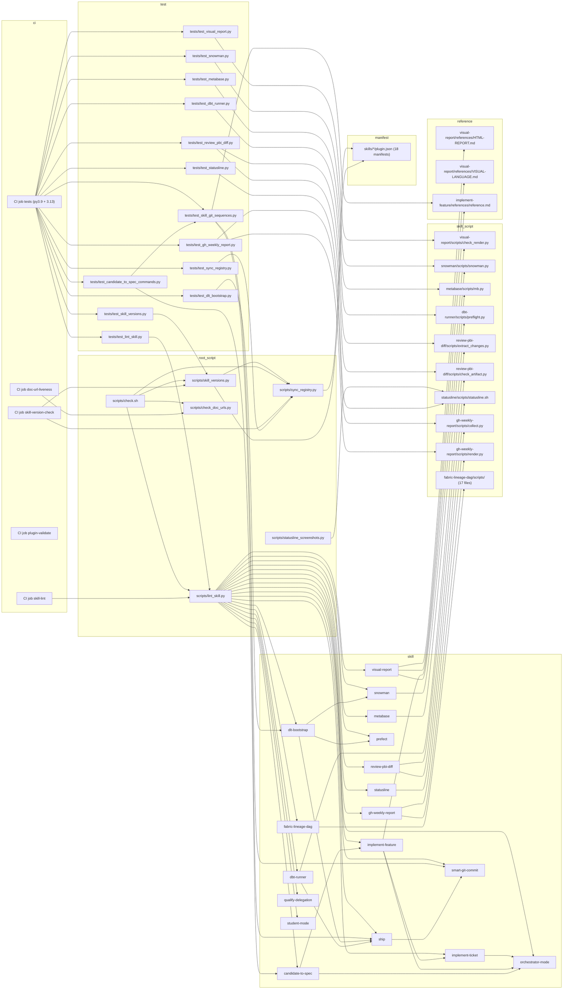

# Content file: "How the relentless-data-skills catalogue is built and checked"

Source of truth for three parallel layout writers. Everything below was measured on
`/Users/tumul/projects_repo/relentless-data-skills` at commit `a590a62` (main, 2026-10-29),
on 2026-10-30. Writers must not explore the repo; use only this file.

## 0. Answer box (the one-sentence claim)

> Every always-loaded SKILL.md fits the 150-line budget that `scripts/lint_skill.py` enforces in CI
> (five of 18 sit exactly on it), so the catalogue's weight lives in scripts and references:
> `fabric-lineage-dag` alone holds 17 of the 26 script files and 21% of the 17,001 tracked lines.

Alternative answer box (if a writer wants the render-check angle):

> `check_render.py` turns what a reader would see into PASS, FAIL or BLOCKED in a 22-line `verdict()` that
> ranks proof of a page defect above environment trouble, and environment trouble above softer evidence.

Headline numbers (all measured):

| Measure | Value |
|---|---|
| Skills under `skills/` | 18 |
| SKILL.md lines, total / mean / budget | 2291 / 127.3 / 150 |
| Skills at exactly 150 lines | 5 (implement-ticket, metabase, prefect, review-pbi-diff, student-mode) |
| Skills with `disable-model-invocation: true` | 8 of 18 |
| Script files under `skills/*/scripts/` | 26 (fabric-lineage-dag: 17) |
| Reference files under `skills/*/references/` | 28 |
| Tracked lines across all skill folders | 17,001 |
| Commits on `main` (whole history) | 124, of which 5 are merge commits |
| First / last commit | 2026-05-21 "feat: initial prefect-skill" / 2026-10-29 "fix(orchestrator-mode) ... (#110)" |
| Test functions in `tests/` | 576 across 13 files |
| Lines in `tests/*.py` + `scripts/*.py` | 7,286 |
| CI jobs in `.github/workflows/ci.yml` | 5 (skill-version-check, tests, skill-lint, plugin-validate, doc-url-liveness) |
| `check_render.py` size | 985 lines; added 2026-10-03 in commit 088a29f (#75) |
| `visual-report` version / SKILL.md lines | 0.1.3 / 56 |

## 1. Table 1: the catalogue (18 rows)

Caption, what it shows: every skill folder under `skills/` with its manifest version, the size of its
always-loaded SKILL.md, how many files it keeps in `references/` and `scripts/`, whether the model may
invoke it on its own, and how many commits have touched the folder.
Caption, how to read it: version comes from `plugin.json`; the line count is `wc -l SKILL.md`; file counts
are `git ls-files` under each subfolder; "DMI" is `disable-model-invocation: true` in the SKILL.md
frontmatter; commits is `git log --oneline -- skills/<name> | wc -l` (a commit touching several skills is
counted once per skill, so the column sums to 210, more than the repo's 124 commits).
So what: the SKILL.md column is nearly flat (56 to 150) while the scripts and commits columns are not; the
budget shapes the prompt, not the skill.

Note for writers: the brief asked for 30+ rows; the repo has exactly 18 skills, so the table has 18 rows.
If you need more rows for layout stress, add the per-skill `tracked_files` and `total_tracked_lines`
columns from the JSON below rather than inventing skills.

| skill | version | SKILL.md lines | references/ files | scripts/ files | DMI | commits |
|---|---|---|---|---|---|---|
| candidate-to-spec | 0.1.1 | 129 | 3 | 0 | yes | 2 |
| dbt-runner | 0.1.8 | 134 | 3 | 1 | no | 15 |
| dlt-bootstrap | 0.1.1 | 133 | 3 | 0 | no | 10 |
| fabric-lineage-dag | 0.1.2 | 89 | 3 | 17 | no | 6 |
| gh-weekly-report | 0.1.2 | 119 | 1 | 2 | yes | 8 |
| implement-feature | 0.2.5 | 142 | 1 | 0 | yes | 21 |
| implement-ticket | 0.2.8 | 150 | 4 | 0 | yes | 22 |
| metabase | 0.1.0 | 150 | 3 | 1 | no | 4 |
| orchestrator-mode | 0.5.4 | 147 | 1 | 0 | no | 25 |
| prefect | 0.2.2 | 150 | 0 | 0 | no | 9 |
| qualify-delegation | 0.1.0 | 123 | 0 | 0 | no | 1 |
| review-pbi-diff | 0.1.3 | 150 | 1 | 2 | yes | 8 |
| ship | 0.1.7 | 148 | 0 | 0 | yes | 17 |
| smart-git-commit | 0.1.3 | 114 | 0 | 0 | no | 13 |
| snowman | 0.1.4 | 143 | 3 | 1 | no | 23 |
| statusline | 0.5.0 | 64 | 0 | 1 | yes | 10 |
| student-mode | 0.2.0 | 150 | 0 | 0 | yes | 4 |
| visual-report | 0.1.3 | 56 | 2 | 1 | no | 12 |
| **total** | | **2291** | **28** | **26** | **8 yes** | **210** |

JSON (same data plus `total_tracked_lines` and `tracked_files` for every tracked file in the folder):

```json
[
 {
  "skill": "candidate-to-spec",
  "version": "0.1.1",
  "skill_md_lines": 129,
  "references_files": 3,
  "scripts_files": 0,
  "disable_model_invocation": true,
  "commits": 2,
  "total_tracked_lines": 728,
  "tracked_files": 6
 },
 {
  "skill": "dbt-runner",
  "version": "0.1.8",
  "skill_md_lines": 134,
  "references_files": 3,
  "scripts_files": 1,
  "disable_model_invocation": false,
  "commits": 15,
  "total_tracked_lines": 1064,
  "tracked_files": 7
 },
 {
  "skill": "dlt-bootstrap",
  "version": "0.1.1",
  "skill_md_lines": 133,
  "references_files": 3,
  "scripts_files": 0,
  "disable_model_invocation": false,
  "commits": 10,
  "total_tracked_lines": 388,
  "tracked_files": 6
 },
 {
  "skill": "fabric-lineage-dag",
  "version": "0.1.2",
  "skill_md_lines": 89,
  "references_files": 3,
  "scripts_files": 17,
  "disable_model_invocation": false,
  "commits": 6,
  "total_tracked_lines": 3635,
  "tracked_files": 23
 },
 {
  "skill": "gh-weekly-report",
  "version": "0.1.2",
  "skill_md_lines": 119,
  "references_files": 1,
  "scripts_files": 2,
  "disable_model_invocation": true,
  "commits": 8,
  "total_tracked_lines": 1060,
  "tracked_files": 6
 },
 {
  "skill": "implement-feature",
  "version": "0.2.5",
  "skill_md_lines": 142,
  "references_files": 1,
  "scripts_files": 0,
  "disable_model_invocation": true,
  "commits": 21,
  "total_tracked_lines": 513,
  "tracked_files": 4
 },
 {
  "skill": "implement-ticket",
  "version": "0.2.8",
  "skill_md_lines": 150,
  "references_files": 4,
  "scripts_files": 0,
  "disable_model_invocation": true,
  "commits": 22,
  "total_tracked_lines": 538,
  "tracked_files": 7
 },
 {
  "skill": "metabase",
  "version": "0.1.0",
  "skill_md_lines": 150,
  "references_files": 3,
  "scripts_files": 1,
  "disable_model_invocation": false,
  "commits": 4,
  "total_tracked_lines": 1803,
  "tracked_files": 7
 },
 {
  "skill": "orchestrator-mode",
  "version": "0.5.4",
  "skill_md_lines": 147,
  "references_files": 1,
  "scripts_files": 0,
  "disable_model_invocation": false,
  "commits": 25,
  "total_tracked_lines": 306,
  "tracked_files": 4
 },
 {
  "skill": "prefect",
  "version": "0.2.2",
  "skill_md_lines": 150,
  "references_files": 0,
  "scripts_files": 0,
  "disable_model_invocation": false,
  "commits": 9,
  "total_tracked_lines": 241,
  "tracked_files": 3
 },
 {
  "skill": "qualify-delegation",
  "version": "0.1.0",
  "skill_md_lines": 123,
  "references_files": 0,
  "scripts_files": 0,
  "disable_model_invocation": false,
  "commits": 1,
  "total_tracked_lines": 183,
  "tracked_files": 3
 },
 {
  "skill": "review-pbi-diff",
  "version": "0.1.3",
  "skill_md_lines": 150,
  "references_files": 1,
  "scripts_files": 2,
  "disable_model_invocation": true,
  "commits": 8,
  "total_tracked_lines": 1927,
  "tracked_files": 6
 },
 {
  "skill": "ship",
  "version": "0.1.7",
  "skill_md_lines": 148,
  "references_files": 0,
  "scripts_files": 0,
  "disable_model_invocation": true,
  "commits": 17,
  "total_tracked_lines": 260,
  "tracked_files": 3
 },
 {
  "skill": "smart-git-commit",
  "version": "0.1.3",
  "skill_md_lines": 114,
  "references_files": 0,
  "scripts_files": 0,
  "disable_model_invocation": false,
  "commits": 13,
  "total_tracked_lines": 183,
  "tracked_files": 3
 },
 {
  "skill": "snowman",
  "version": "0.1.4",
  "skill_md_lines": 143,
  "references_files": 3,
  "scripts_files": 1,
  "disable_model_invocation": false,
  "commits": 23,
  "total_tracked_lines": 1601,
  "tracked_files": 7
 },
 {
  "skill": "statusline",
  "version": "0.5.0",
  "skill_md_lines": 64,
  "references_files": 0,
  "scripts_files": 1,
  "disable_model_invocation": true,
  "commits": 10,
  "total_tracked_lines": 1038,
  "tracked_files": 8
 },
 {
  "skill": "student-mode",
  "version": "0.2.0",
  "skill_md_lines": 150,
  "references_files": 0,
  "scripts_files": 0,
  "disable_model_invocation": true,
  "commits": 4,
  "total_tracked_lines": 215,
  "tracked_files": 3
 },
 {
  "skill": "visual-report",
  "version": "0.1.3",
  "skill_md_lines": 56,
  "references_files": 2,
  "scripts_files": 1,
  "disable_model_invocation": false,
  "commits": 12,
  "total_tracked_lines": 1318,
  "tracked_files": 6
 }
]
```

Column notes:
- `version` ranges 0.1.0 (metabase, qualify-delegation) to 0.5.4 (orchestrator-mode). Per ADR-0001 every
  merged PR that touches a skill folder bumps that skill once, patch by default; new skills start at 0.1.0.
- `references/` is 0 for 6 skills (prefect, qualify-delegation, ship, smart-git-commit, statusline, student-mode).
- `scripts/` is 0 for 10 skills; the 8 with scripts hold 26 files, 17 of them in fabric-lineage-dag.

## 2. Figure 1: SKILL.md lines per skill against the 150-line budget (bar chart)

Caption, what it shows: the length of each skill's SKILL.md, sorted descending, with a reference line at
150, the `LINE_BUDGET` constant in `scripts/lint_skill.py` (line 35).
Caption, how to read it: a bar touching the line is at the limit, not over it; the linter fails any
SKILL.md above 150 ("SKILL.md is N lines (budget 150)", line 160) and CI's `skill-lint` job runs it on
every push and PR. The source comment (lines 32-34) says the budget is "deliberately stricter than the
docs' 500-line guidance" so detail moves into `references/`.
So what: 5 skills sit exactly on the budget and two more are within 3 lines of it; the ceiling is
load-bearing, not nominal.

```json
[{"skill": "implement-ticket", "lines": 150}, {"skill": "metabase", "lines": 150}, {"skill": "prefect", "lines": 150}, {"skill": "review-pbi-diff", "lines": 150}, {"skill": "student-mode", "lines": 150}, {"skill": "ship", "lines": 148}, {"skill": "orchestrator-mode", "lines": 147}, {"skill": "snowman", "lines": 143}, {"skill": "implement-feature", "lines": 142}, {"skill": "dbt-runner", "lines": 134}, {"skill": "dlt-bootstrap", "lines": 133}, {"skill": "candidate-to-spec", "lines": 129}, {"skill": "qualify-delegation", "lines": 123}, {"skill": "gh-weekly-report", "lines": 119}, {"skill": "smart-git-commit", "lines": 114}, {"skill": "fabric-lineage-dag", "lines": 89}, {"skill": "statusline", "lines": 64}, {"skill": "visual-report", "lines": 56}]
```

Reference line: `{"label": "LINE_BUDGET (scripts/lint_skill.py:35)", "value": 150}`.
Mean 127.3; min 56 (visual-report); max 150; skills within 5 lines of the budget: 7.

## 3. Figure 2: commits per month over the repo's history (line chart)

Caption, what it shows: commits on `main` by author month, from the first commit (2026-05-21) to the last
(2026-10-29).
Caption, how to read it: measured with `git log --date=format:%Y-%m --pretty=%ad | sort | uniq -c`; the
count includes the 5 merge commits; the x-axis has six points and the y-axis spans 4 to 37.
So what: activity comes in two waves, June (37) and September-October (59), with a quiet July-August (24).

```json
[{"month": "2026-05", "commits": 4}, {"month": "2026-06", "commits": 37}, {"month": "2026-07", "commits": 14}, {"month": "2026-08", "commits": 10}, {"month": "2026-09", "commits": 23}, {"month": "2026-10", "commits": 36}]
```

Total 124. Peaks: 2026-06 (37) and 2026-10 (36). Trough: 2026-08 (10).

## 4. Figure 3: dependency graph among skills, shared scripts, tests and CI (DAG)

Caption, what it shows: 56 nodes and 84 directed edges. Nodes are the 18 skills, 6 root scripts,
the 18 `plugin.json` manifests as one node, 5 CI jobs, 13 test files, 10 skill-owned script nodes
(fabric-lineage-dag's 17 scripts collapsed into one) and 3 reference files that something outside their
own skill reads.
Caption, how to read it: an edge A --> B means A names, runs, imports or reads B. Skill-to-skill edges
come from grep of SKILL.md and `references/` only (README-only mentions are listed separately below);
test edges come from each test module's import or file-path constants; CI edges from `ci.yml`; the
`lint_skill.py --> <skill>` fan-out exists because the linter reads every `skills/*/SKILL.md`.
So what: the graph has two hubs that are not skills: `scripts/lint_skill.py` (degree 21) and
the CI `tests` job (degree 13); among skills, `orchestrator-mode` is the most depended-on
(in-degree 3 from skills, plus the linter), and `visual-report` is wired only to its own script, its two
references, the linter and one test.

Hub nodes by total degree (in + out):

| node | degree |
|---|---|
| scripts/lint_skill.py | 21 |
| CI job tests (py3.9 + 3.13) | 13 |
| implement-feature | 5 |
| ship | 5 |
| dlt-bootstrap | 5 |
| scripts/skill_versions.py | 5 |
| scripts/sync_registry.py | 5 |
| tests/test_skill_git_sequences.py | 5 |

Node table (id, label, group, degree):

| id | label | group | degree |
|---|---|---|---|
| candidate-to-spec | candidate-to-spec | skill | 4 |
| dbt-runner | dbt-runner | skill | 3 |
| dlt-bootstrap | dlt-bootstrap | skill | 5 |
| fabric-lineage-dag | fabric-lineage-dag | skill | 2 |
| gh-weekly-report | gh-weekly-report | skill | 3 |
| implement-feature | implement-feature | skill | 5 |
| implement-ticket | implement-ticket | skill | 3 |
| metabase | metabase | skill | 2 |
| orchestrator-mode | orchestrator-mode | skill | 4 |
| prefect | prefect | skill | 2 |
| qualify-delegation | qualify-delegation | skill | 1 |
| review-pbi-diff | review-pbi-diff | skill | 3 |
| ship | ship | skill | 5 |
| smart-git-commit | smart-git-commit | skill | 3 |
| snowman | snowman | skill | 3 |
| statusline | statusline | skill | 2 |
| student-mode | student-mode | skill | 1 |
| visual-report | visual-report | skill | 4 |
| lint_skill | scripts/lint_skill.py | root-script | 21 |
| sync_registry | scripts/sync_registry.py | root-script | 5 |
| skill_versions | scripts/skill_versions.py | root-script | 5 |
| check_doc_urls | scripts/check_doc_urls.py | root-script | 2 |
| check_sh | scripts/check.sh | root-script | 4 |
| statusline_shots | scripts/statusline_screenshots.py | root-script | 1 |
| plugin_json | skills/*/plugin.json (18 manifests) | manifest | 2 |
| ci_version | CI job skill-version-check | ci | 2 |
| ci_tests | CI job tests (py3.9 + 3.13) | ci | 13 |
| ci_lint | CI job skill-lint | ci | 1 |
| ci_plugin | CI job plugin-validate | ci | 0 |
| ci_urls | CI job doc-url-liveness | ci | 1 |
| test_candidate_to_spec_commands | tests/test_candidate_to_spec_commands.py | test | 3 |
| test_dbt_runner | tests/test_dbt_runner.py | test | 2 |
| test_dlt_bootstrap | tests/test_dlt_bootstrap.py | test | 2 |
| test_gh_weekly_report | tests/test_gh_weekly_report.py | test | 3 |
| test_lint_skill | tests/test_lint_skill.py | test | 2 |
| test_metabase | tests/test_metabase.py | test | 2 |
| test_review_pbi_diff | tests/test_review_pbi_diff.py | test | 3 |
| test_skill_git_sequences | tests/test_skill_git_sequences.py | test | 5 |
| test_skill_versions | tests/test_skill_versions.py | test | 2 |
| test_snowman | tests/test_snowman.py | test | 2 |
| test_statusline | tests/test_statusline.py | test | 2 |
| test_sync_registry | tests/test_sync_registry.py | test | 2 |
| test_visual_report | tests/test_visual_report.py | test | 2 |
| check_render | visual-report/scripts/check_render.py | skill-script | 2 |
| snowman_py | snowman/scripts/snowman.py | skill-script | 2 |
| mb_py | metabase/scripts/mb.py | skill-script | 2 |
| preflight_py | dbt-runner/scripts/preflight.py | skill-script | 2 |
| extract_changes | review-pbi-diff/scripts/extract_changes.py | skill-script | 2 |
| check_artifact | review-pbi-diff/scripts/check_artifact.py | skill-script | 2 |
| statusline_sh | statusline/scripts/statusline.sh | skill-script | 3 |
| collect_py | gh-weekly-report/scripts/collect.py | skill-script | 2 |
| render_py | gh-weekly-report/scripts/render.py | skill-script | 2 |
| fld_scripts | fabric-lineage-dag/scripts/ (17 files) | skill-script | 1 |
| html_report | visual-report/references/HTML-REPORT.md | reference | 1 |
| visual_language | visual-report/references/VISUAL-LANGUAGE.md | reference | 1 |
| if_reference | implement-feature/references/reference.md | reference | 2 |

Edge list (`A --> B`, ids as in the node table), grouped:

A. skill -> skill (named in SKILL.md or references/)

candidate-to-spec --> implement-feature
candidate-to-spec --> orchestrator-mode
dbt-runner --> ship
dlt-bootstrap --> prefect
dlt-bootstrap --> ship
dlt-bootstrap --> snowman
implement-feature --> implement-ticket
implement-feature --> orchestrator-mode
implement-ticket --> orchestrator-mode
ship --> smart-git-commit

B. skill -> its own scripts and references (named in SKILL.md)

dbt-runner --> preflight_py
metabase --> mb_py
review-pbi-diff --> extract_changes
review-pbi-diff --> check_artifact
gh-weekly-report --> collect_py
gh-weekly-report --> render_py
fabric-lineage-dag --> fld_scripts
statusline --> statusline_sh
snowman --> snowman_py
visual-report --> check_render
visual-report --> html_report
visual-report --> visual_language
implement-feature --> if_reference

C. test -> what it exercises (module import or file read)

test_lint_skill --> lint_skill
test_skill_versions --> skill_versions
test_sync_registry --> sync_registry
test_dbt_runner --> preflight_py
test_metabase --> mb_py
test_review_pbi_diff --> extract_changes
test_review_pbi_diff --> check_artifact
test_snowman --> snowman_py
test_statusline --> statusline_sh
test_visual_report --> check_render
test_gh_weekly_report --> collect_py
test_gh_weekly_report --> render_py
test_dlt_bootstrap --> dlt-bootstrap
test_candidate_to_spec_commands --> candidate-to-spec
test_candidate_to_spec_commands --> test_skill_git_sequences
test_skill_git_sequences --> if_reference
test_skill_git_sequences --> ship
test_skill_git_sequences --> smart-git-commit

D. CI job -> what it runs (.github/workflows/ci.yml)

ci_version --> skill_versions
ci_version --> sync_registry
ci_lint --> lint_skill
ci_urls --> check_doc_urls
ci_tests --> test_candidate_to_spec_commands
ci_tests --> test_dbt_runner
ci_tests --> test_dlt_bootstrap
ci_tests --> test_gh_weekly_report
ci_tests --> test_lint_skill
ci_tests --> test_metabase
ci_tests --> test_review_pbi_diff
ci_tests --> test_skill_git_sequences
ci_tests --> test_skill_versions
ci_tests --> test_snowman
ci_tests --> test_statusline
ci_tests --> test_sync_registry
ci_tests --> test_visual_report

E. root script -> what it runs or reads

check_sh --> lint_skill
check_sh --> sync_registry
check_sh --> skill_versions
check_sh --> check_doc_urls
skill_versions --> sync_registry
skill_versions --> plugin_json
sync_registry --> plugin_json
statusline_shots --> statusline_sh
lint_skill --> candidate-to-spec
lint_skill --> dbt-runner
lint_skill --> dlt-bootstrap
lint_skill --> fabric-lineage-dag
lint_skill --> gh-weekly-report
lint_skill --> implement-feature
lint_skill --> implement-ticket
lint_skill --> metabase
lint_skill --> orchestrator-mode
lint_skill --> prefect
lint_skill --> qualify-delegation
lint_skill --> review-pbi-diff
lint_skill --> ship
lint_skill --> smart-git-commit
lint_skill --> snowman
lint_skill --> statusline
lint_skill --> student-mode
lint_skill --> visual-report

README-only skill mentions (not in the edge count above; include as dashed edges if wanted):
smart-git-commit --> ship, implement-ticket --> implement-feature, candidate-to-spec --> (also) implement-feature.

Omitted on purpose: 26 of the 28 `references/*.md` files (each is named only by its own SKILL.md/README);
the `plugin-validate` CI job runs `claude plugin validate .`, which is not a repo script, so it has no
outgoing edge; `check.sh` also runs `python3 -m unittest discover -s tests`, equivalent to the `tests` job.

Ready-to-paste Mermaid (ids with `-` replaced by `_`; subgraphs per group):



## 5. Figure 4: sequence of `skills/visual-report/scripts/check_render.py` (sequence diagram)

Caption, what it shows: one run of the render check from the agent's command to the verdict line, with
five participants: Agent, Script (check_render.py), Chromium (headless, via Playwright), CDNs
(cdn.tailwindcss.com, cdn.jsdelivr.net and the other hosts in `CDN_HOSTS`), and the Report file.
Caption, how to read it: solid arrows are calls the script makes; the dashed returns carry facts the
script reads; `alt` boxes are the branches that end in BLOCKED or FAIL before the normal path completes.
Timings are the constants at the top of the file: LOAD_TIMEOUT_S 30, QUIET_MS 2000, CALL_TIMEOUT_S 10,
PROBE_TIMEOUT_S 15, default `--timeout` 20, overall limit 30 + 20 + 90 = 140 s, watchdog 160 s.
So what: the script never trusts the console; it reads the rendered DOM twice (before and after opening
hidden containers), re-renders suspect diagrams offscreen, and asks a known-good CDN URL whether the
network is to blame before it lets an unrendered diagram count as a defect.

Invocation (SKILL.md line 39):
`uv run --no-project --with playwright python <skill-dir>/scripts/check_render.py <report.html>`
Options: `--shots DIR` (default `<report-stem>-check/` beside the report), `--timeout N` (default 20 s).

Numbered steps (who -> whom: what):

1. Agent -> Script: run `check_render.py REPORT.html [--shots DIR] [--timeout 20]` (`main()`, line 934).
2. Script -> Report file: `read_source(report)` reads the HTML text (line 948).
   alt OSError: Script appends "cannot read the report" to `page_errors` and calls `emit()` at once; `verdict()` returns FAIL (exit 1).
3. Script: `from playwright.async_api import async_playwright` (line 955).
   alt ImportError: `result["blocked"]` = "playwright is not importable; run this script with uv run ... or pip install playwright"; `emit()` -> BLOCKED (exit 2).
4. Script: starts a daemon watchdog `threading.Timer(limit + 20)` = 160 s that, if it fires, sets `incomplete` and emits with `os._exit` (lines 965-970).
5. Script -> Chromium: `launch(pw)` headless browser (line 789).
   alt no browser: `result["blocked"]` = "no browser could launch (...); install one with `uv run --no-project --with playwright playwright install chromium`" -> BLOCKED.
6. Script -> Chromium: `new_page(viewport 1280x900)`, open a CDP session, attach the `Net` request recorder, hook `pageerror` and `console`, `add_init_script(INIT_JS)` which installs `window.__vrCheck` (lines 805-813).
7. Script -> Chromium: `goto(file://REPORT.html, wait_until="load", timeout 30 s)` (line 817).
   Chromium -> CDNs: GET Tailwind script, Mermaid ESM module and anything else the page imports.
   CDNs -> Chromium: responses; `Net` records each as reached, failed (with `net::ERR_*`) or HTTP status.
   alt load timeout after 30 s: Script keeps the still-inflight URLs as `pending` and continues (line 821).
8. Script -> Chromium: `settle()` polls `__vrCheck.facts()` until Mermaid's output is unchanged for 2000 ms, giving up after `--timeout` (20 s) with the warning "diagrams were still changing after 20 s; checked as they were" (lines 824-825).
9. Script -> Chromium: `facts()` snapshot `before`; then `__vrCheck.reveal()` opens tabs, toggles and `<details>` as a reader would; if anything was revealed, sleep 0.3 s and settle again (5 s, 500 ms quiet); `facts()` again (lines 826-830).
10. Script: for each diagram, `diagram_status(fact)` classifies it as error, rendering, lazy, unrendered, hidden, illegible, empty, clipped or ok (lines 242-271); adds warnings for labels under 9 px or a diagram running past the window's right edge; marks still-hidden diagrams `unverified` (lines 832-855).
11. Script -> Chromium: `__vrCheck.images()` (broken and still-loading ``), the text of every `<script type=module>`, then `screenshots()` writes `page-<k>.png` viewport slices (max 40) and `diagram-<n>.png` per diagram into the shots dir (lines 857-859).
12. Script: `net.frozen = True` so its own requests no longer count (line 862). For up to 20 diagrams whose status is error, empty or lazy, or ok but drawn while hidden, Script -> Chromium: `__vrCheck.probe(module, source, n)` re-renders the diagram source offscreen with the page's own Mermaid module (15 s each); `explain(d, out)` attaches Mermaid's error text or sets `env` when the probe shows the module never loaded (lines 864-875).
13. alt no remote host answered and some request failed or is pending: Script -> Chromium -> CDNs: `fetch("https://cdn.jsdelivr.net/npm/mermaid@11/package.json", no-cors, 5 s)` to tell a typo in the page from no network at all; result is `network_ok` (lines 879-888).
14. Script: `request_problem(url, failure, status, network_ok)` for every failed and pending request -> ("defect", why) or ("blocked", why) (lines 889-898); `broken_images` = broken `` whose URL is not a blocked CDN URL (line 900); `page_errors` and `console_errors` are de-duplicated with counts (lines 908-909).
15. Script -> Chromium: `browser.close()` with a 10 s cap (lines 797-800).
   alt the page froze (a `__vrCheck` call took over 10 s): `Hung` is raised, `result["hung"]` says why, and the run falls through to emit -> FAIL.
   alt `asyncio.TimeoutError` at 140 s: `incomplete` = "the check did not finish within 140 s" -> BLOCKED.
   alt any other exception: `blocked` = "the check itself failed: <Type>: <first line>" -> BLOCKED.
16. Script: `emit()` maps each diagram back to its source line (`assign_lines`), strips private keys, computes `verdict(result)` (lines 354-375) and `problems()` when not PASS, prints the JSON result then a bare `PASS`, `FAIL` or `BLOCKED` line, and exits 0, 1 or 2 (lines 916-931).
17. Script -> Agent: exit code and the final line. SKILL.md then tells the agent: FAIL -> fix every `problems` line and rerun; BLOCKED -> unverified, apply the printed fix or hand over saying so; PASS -> read every screenshot and resolve every warning.

## 6. Figure 5: annotated code excerpt, where the verdict is decided

Caption, what it shows: lines 354-375 of `skills/visual-report/scripts/check_render.py`, the whole
`verdict()` function (22 lines).
Caption, how to read it: the four `if` blocks are a precedence ladder; the first one that matches wins,
so a defect in the page outranks an environment problem, which outranks the softer evidence of
unrendered blocks and console errors.
So what: the ordering is the design: an unreachable CDN explains an unrendered diagram, so the script
refuses to call that a page defect.

```python
354 def verdict(result):
355     """Proof of a defect beats an environment problem, which beats softer evidence.
356 
357     An error diagram, a 404, or a broken image is a defect whatever else went
358     wrong. An unreachable CDN explains unrendered diagrams and script errors,
359     so those count only when the network was fine.
360     """
361     if result.get("blocked"):
362         return BLOCKED
363     diagrams = result.get("diagrams", [])
364     requests = result.get("requests", [])
365     if (any(d["status"] in DRAWN_BAD and not d.get("env") for d in diagrams)
366             or any(r["kind"] == "defect" for r in requests)
367             or result.get("broken_images") or result.get("hung")):
368         return FAIL
369     if (any(r["kind"] == "blocked" for r in requests)
370             or any(d.get("env") for d in diagrams) or result.get("incomplete")):
371         return BLOCKED
372     if (any(d["status"] in NOT_DRAWN for d in diagrams)
373             or result.get("page_errors") or result.get("console_errors")):
374         return FAIL
375     return PASS
```

Callouts (line -> one sentence):
- Line 361: `result["blocked"]` is set only when the check could not run at all (no Playwright, no browser, the script itself crashed), so it short-circuits everything else.
- Line 365: `DRAWN_BAD` is `{"error", "empty", "illegible", "clipped"}`, statuses where Mermaid ran and drew something wrong, which is proof of a defect unless the probe marked the diagram `env` (its module never loaded).
- Line 367: a broken image or a frozen tab (`hung`) is a FAIL on its own, with no network excuse.
- Line 369-370: a request classified "blocked" (a CDN host unreachable or answering 5xx), an `env`-flagged diagram, or a timed-out check means the page is unverified, so BLOCKED beats the softer FAILs below.
- Line 372: `NOT_DRAWN` is `{"unrendered", "rendering"}`; together with page and console errors these only count once lines 369-370 have ruled out a network explanation.

Supporting constants (lines 50-75): `PASS, FAIL, BLOCKED = "PASS", "FAIL", "BLOCKED"`; `EXIT = {PASS: 0, FAIL: 1, BLOCKED: 2}`;
`MIN_LABEL_PX = 6` (below this: illegible, FAIL); `SMALL_LABEL_PX = 9` (warn); `TINY_PX = 24` (a speck);
`CDN_HOSTS = {cdn.tailwindcss.com, cdn.jsdelivr.net, fastly.jsdelivr.net, unpkg.com, esm.sh, cdnjs.cloudflare.com}`.

## 7. Figure 6: which condition produces which verdict (comparison matrix)

Caption, what it shows: the conditions named in the script's module docstring (lines 2-25) as rows, the
three verdicts as columns; a filled cell is the verdict that condition produces on its own.
Caption, how to read it: when several conditions hold at once, Figure 5's ladder applies: any FAIL in the
"defect" tier (rows 1-7) beats BLOCKED, and BLOCKED beats the "soft" FAIL tier (rows 8-9).
So what: only three rows end in BLOCKED, and all three are the environment's fault, which is why SKILL.md
says "BLOCKED means unverified, not passing".

| # | Condition (docstring wording) | Status / field in `result` | PASS | FAIL | BLOCKED | Tier |
|---|---|---|---|---|---|---|
| 1 | Diagram is Mermaid's error diagram | `status: error` (DRAWN_BAD) | | X | | defect |
| 2 | Diagram collapsed to a speck or shows no labels | `status: empty` (DRAWN_BAD) | | X | | defect |
| 3 | Diagram shrunk until labels are unreadable (<6 px) | `status: illegible` (DRAWN_BAD) | | X | | defect |
| 4 | Diagram cut off by an overflow:hidden box | `status: clipped` (DRAWN_BAD) | | X | | defect |
| 5 | Broken image | `broken_images` non-empty | | X | | defect |
| 6 | Resource answers 404, or a non-CDN host does not exist while others loaded | `requests[].kind == "defect"` | | X | | defect |
| 7 | Page freezes its tab (a query takes over 10 s) | `hung` set | | X | | defect |
| 8 | Diagram never rendered / still rendering (network fine) | `status: unrendered` or `rendering` (NOT_DRAWN) | | X | | soft |
| 9 | Page error or console error (network fine) | `page_errors` / `console_errors` | | X | | soft |
| 10 | No Playwright import or no browser could launch | `blocked` set | | | X | environment |
| 11 | A CDN host unreachable or answering HTTP 5xx | `requests[].kind == "blocked"` or diagram `env` | | | X | environment |
| 12 | Check did not finish within 140 s (or watchdog at 160 s) | `incomplete` set | | | X | environment |
| 13 | Diagram still hidden after reveal (listed, not judged) | `unverified` | X (listed) | | | note |
| 14 | None of the above | | X | | | |

Exit codes: PASS 0, FAIL 1, BLOCKED 2. Row 8 becomes BLOCKED, not FAIL, when row 11 also holds (that is the point of the ladder).

## 8. Figure 7: the last 12 commits touching `skills/visual-report/` (timeline)

Caption, what it shows: every commit on `main` that touched the visual-report folder, oldest at the
left; this is also the folder's whole history (12 commits in total).
Caption, how to read it: the pivotal mark is 088a29f, which added `check_render.py` (985 lines) and
`tests/test_visual_report.py` (345 lines) in a PR that also gave review-pbi-diff and ship their own
"prove-it-works" checks; everything before it is prose and style passes.
So what: the render check arrived four months after the skill, in one 2,605-insertion PR, and the three
commits since have only touched docs and config.

| # | hash | date | subject | note |
|---|---|---|---|---|
| 1 | 6db3ef0 | 2026-06-09 | feat: add visual-report skill | skill created |
| 2 | f9b72a8 | 2026-06-09 | docs(skills): add prefect debug/CLI protocol and visual-report improvements | |
| 3 | dc10b07 | 2026-06-09 | chore: remove license and version from multiple skill files | |
| 4 | 49a91cc | 2026-06-12 | Generate marketplace.json and the README skills table from plugin.json (#27) | plugin.json becomes source of truth |
| 5 | 5961bf5 | 2026-06-18 | docs(skills): quality pass across all 9 skills (#28) | catalogue had 9 skills |
| 6 | 83b2c2b | 2026-07-24 | docs(skills): tune all skills for Opus 5 prompting guidance (#41) | |
| 7 | fa5e069 | 2026-09-03 | docs: remove em dashes from skill docs prose (#59) | |
| 8 | ebdcdce | 2026-09-03 | snowman: token-efficient CSV output, cleaner errors, plain-language docs (#61) | |
| 9 | 207218c | 2026-09-16 | docs(skills): refresh descriptions and documentation links (#69) | |
| 10 | 3db5ecb | 2026-09-23 | chore(skills): apply prompt audit for Fable 5.1 (#71) | |
| 11 | **088a29f** | **2026-10-03** | **feat(skills): add prove-it-works checks (#75)** | **PIVOTAL: adds scripts/check_render.py (+985) and tests/test_visual_report.py (+345); 16 files, +2605/-41** |
| 12 | dc788de | 2026-10-18 | chore: migrate agent config to GLOSSARY.md and AGENTS.md (#91) | |

```json
[
 {"hash":"6db3ef0","date":"2026-06-09","subject":"feat: add visual-report skill","pivotal":false},
 {"hash":"f9b72a8","date":"2026-06-09","subject":"docs(skills): add prefect debug/CLI protocol and visual-report improvements","pivotal":false},
 {"hash":"dc10b07","date":"2026-06-09","subject":"chore: remove license and version from multiple skill files","pivotal":false},
 {"hash":"49a91cc","date":"2026-06-12","subject":"Generate marketplace.json and the README skills table from plugin.json (#27)","pivotal":false},
 {"hash":"5961bf5","date":"2026-06-18","subject":"docs(skills): quality pass across all 9 skills (#28)","pivotal":false},
 {"hash":"83b2c2b","date":"2026-07-24","subject":"docs(skills): tune all skills for Opus 5 prompting guidance (#41)","pivotal":false},
 {"hash":"fa5e069","date":"2026-09-03","subject":"docs: remove em dashes from skill docs prose (#59)","pivotal":false},
 {"hash":"ebdcdce","date":"2026-09-03","subject":"snowman: token-efficient CSV output, cleaner errors, plain-language docs (#61)","pivotal":false},
 {"hash":"207218c","date":"2026-09-16","subject":"docs(skills): refresh descriptions and documentation links (#69)","pivotal":false},
 {"hash":"3db5ecb","date":"2026-09-23","subject":"chore(skills): apply prompt audit for Fable 5.1 (#71)","pivotal":false},
 {"hash":"088a29f","date":"2026-10-03","subject":"feat(skills): add prove-it-works checks (#75)","pivotal":true},
 {"hash":"dc788de","date":"2026-10-18","subject":"chore: migrate agent config to GLOSSARY.md and AGENTS.md (#91)","pivotal":false}
]
```

## 9. Figure 8: total tracked lines per skill folder, top 10 (proportion bars)

Caption, what it shows: the ten largest skill folders by lines across every git-tracked file (SKILL.md,
README, plugin.json, references, scripts, assets), as a share of the 17,001-line catalogue.
Caption, how to read it: each bar's length is the folder's share; the top five together are 60.5% of all
tracked lines, and the remaining 8 skills (not shown) share 13.4%.
So what: line count follows scripts, not prose; the four largest folders are the four with the most
script code, while the most-committed skill (orchestrator-mode, 25 commits) is only 306 lines.

```json
[{"skill": "fabric-lineage-dag", "lines": 3635, "share_pct": 21.4}, {"skill": "review-pbi-diff", "lines": 1927, "share_pct": 11.3}, {"skill": "metabase", "lines": 1803, "share_pct": 10.6}, {"skill": "snowman", "lines": 1601, "share_pct": 9.4}, {"skill": "visual-report", "lines": 1318, "share_pct": 7.8}, {"skill": "dbt-runner", "lines": 1064, "share_pct": 6.3}, {"skill": "gh-weekly-report", "lines": 1060, "share_pct": 6.2}, {"skill": "statusline", "lines": 1038, "share_pct": 6.1}, {"skill": "candidate-to-spec", "lines": 728, "share_pct": 4.3}, {"skill": "implement-ticket", "lines": 538, "share_pct": 3.2}]
```

Full ranking (all 18, lines): fabric-lineage-dag 3635, review-pbi-diff 1927, metabase 1803, snowman 1601,
visual-report 1318, dbt-runner 1064, gh-weekly-report 1060, statusline 1038, candidate-to-spec 728,
implement-ticket 538, implement-feature 513, dlt-bootstrap 388, orchestrator-mode 306, ship 260,
prefect 241, student-mode 215, qualify-delegation 183, smart-git-commit 183.

## 10. How the catalogue is checked (context for the writers, all from the repo)

- `scripts/lint_skill.py` (CI job `skill-lint`, and `scripts/check.sh`): required frontmatter keys
  `name` and `description`; only known keys; a "Use when" clause unless DMI is true; 1024-char description
  cap; 150-line budget; YAML-safe values; and a side-effect rule: a skill whose files contain a command
  that acts on shared state (`gh pr merge`, `git push`, ...) must set `disable-model-invocation: true` or
  be allow-listed with a reason. Exit 0 clean, 1 errors.
- `scripts/skill_versions.py --check --base <baseline>` (CI job `skill-version-check`): every PR that
  changes a tracked file inside a skill folder needs one version bump for that skill (README edits,
  assets, scripts, deletions, permission changes all count). `--write` bumps changed skills (patch by
  default; `--bump minor|major`) and regenerates the registry. Governed by ADR-0001 "Version the whole
  skill once per merged pull request".
- `scripts/sync_registry.py --check` (same CI job): `skills/<skill>/plugin.json` is the single source of
  truth; the marketplace JSON and the README skills table are generated from it.
- CI job `tests`: `python -m unittest discover -s tests -v` on Python 3.9 and 3.13; 576 test functions,
  stdlib only. CI job `plugin-validate`: `claude plugin validate .` on Node 22. CI job `doc-url-liveness`:
  `scripts/check_doc_urls.py`, also on a Monday 06:00 UTC schedule.
- `scripts/check.sh [--fast] [--network] [--base <ref>]` runs lint, registry check, version check, unit
  tests, `claude plugin validate` if available, and optionally the URL check, stopping at the first failure.
- The visual-report skill's own verify step is `check_render.py` (Figures 4-6). Its tests,
  `tests/test_visual_report.py`, hold 49 test functions.

## 11. Takeaways

1. All 18 SKILL.md files are at or under the 150-line budget, five sit exactly on it, and the mean is 127 lines; the linter that enforces the budget runs on every push and PR.
2. Script code, not prompt text, is where the catalogue's bulk lives: fabric-lineage-dag's 17 scripts make its folder 3,635 lines, 21% of the 17,001 tracked lines, with an 89-line SKILL.md.
3. Eight of 18 skills carry `disable-model-invocation: true`; the linter forces it onto any skill whose files run a shared-state command such as `git push` or `gh pr merge`.
4. The repo's 124 commits arrive in two waves, June (37) and September-October (59); orchestrator-mode (25), snowman (23) and implement-ticket (22) are the most-touched skill folders.
5. The render check reached visual-report on 2026-10-03, four months after the skill, in one PR that added 985 lines of checker and 345 lines of tests; the folder's 12-commit history is otherwise docs passes.
6. `verdict()` decides in 22 lines with a fixed precedence: a drawn defect, 404, broken image or frozen tab is FAIL; an unreachable CDN, missing browser or timed-out check is BLOCKED; an unrendered block or console error is FAIL only when the network was fine.

## 12. Limits

1. Commit counts include the 5 merge commits, and a commit that touches several skill folders is counted once per folder, so Table 1's commits column sums to 210, not 124.
2. Skill-to-skill and test-to-skill edges are grep- and import-based: a skill name appearing in prose counts as an edge, and nothing here verifies the dependency is exercised at run time.
3. "Tracked lines" counts every git-tracked file in a folder with `wc -l`, including README and plugin.json, and treats binary assets (statusline's screenshots) as zero or a few lines.
4. The sequence in Figure 4 was read from the source, not traced from a live run; no report was actually rendered to produce this content, and the CI job list reflects `ci.yml` at commit a590a62 only.

## 13. Vocabulary (verbatim from GLOSSARY.md)

- **Skill**: an independently versioned bundle of agent instructions and supporting files. Its documentation belongs to the same bundle.
- **Skill update**: a set of changes delivered together to one skill. Documentation corrections count as updates, even when the skill's behavior stays the same.
- **Skill version**: the identifier of a skill revision, used to track changes and support updates to installed copies.

Related repo wording to reuse: "render check" (the verify step), "prove-it-works checks" (the PR title that
added it), "unverified, not passing" (SKILL.md's gloss on BLOCKED), "progressive disclosure" (lint_skill.py's
reason for the budget), "registry" (the generated marketplace.json plus README table).

## 14. Source commands (so a writer can cite method without rerunning)

- Table 1: `jq .version skills/<s>/plugin.json`; `wc -l skills/<s>/SKILL.md`; `git ls-files skills/<s>/references | wc -l`; `git ls-files skills/<s>/scripts | wc -l`; frontmatter grep for `disable-model-invocation: true`; `git log --oneline -- skills/<s> | wc -l`.
- Figure 2: `git log --date=format:%Y-%m --pretty=%ad | sort | uniq -c`.
- Figure 7: `git log -12 --date=short --pretty='%h %ad %s' -- skills/visual-report` and `git log --diff-filter=A -- skills/visual-report/scripts/check_render.py`.
- Figure 8: `git ls-files skills/<s> | xargs wc -l`.
- Budget: `grep -n LINE_BUDGET scripts/lint_skill.py` -> line 35.
