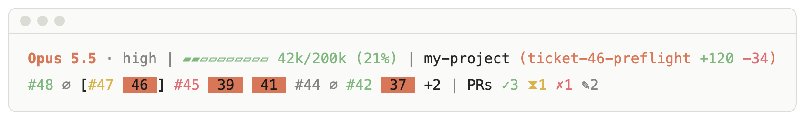
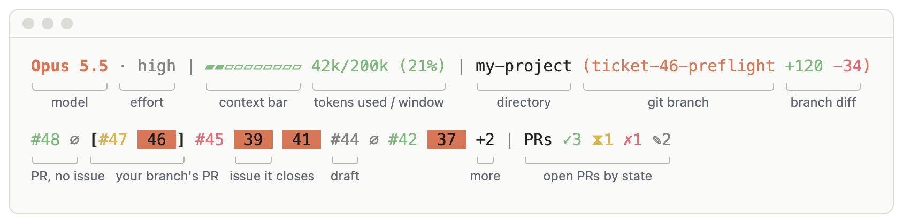
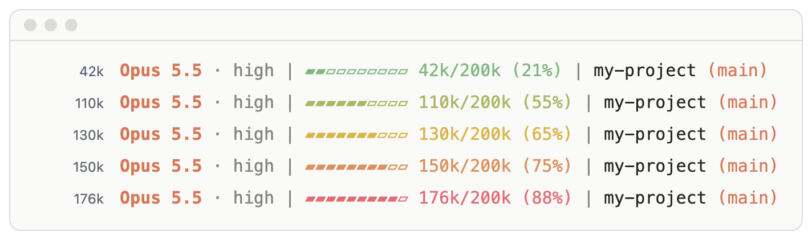
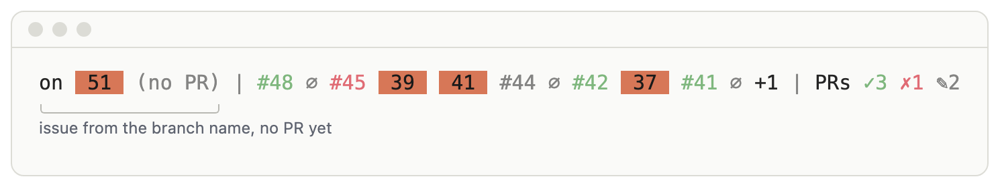

# statusline

The **`statusline`** agent skill installs a Claude Code status line. The status
line shows the current model, reasoning effort, context window usage,
directory, git branch, and open pull requests under the prompt.

<picture>
  <source media="(prefers-color-scheme: dark)" srcset="assets/overview-dark.png">
  
</picture>

## Reading the status line

<picture>
  <source media="(prefers-color-scheme: dark)" srcset="assets/anatomy-dark.png">
  
</picture>

### First line

| Part | Example | Meaning |
| --- | --- | --- |
| Model | `Opus 5.5` | Display name of the model in use. |
| Effort | `· high` | Reasoning effort. It follows `/effort` changes mid-session. Models without an effort setting show the name only. |
| Context bar | `▰▰▱▱▱▱▱▱▱▱` | Tokens used, one cell per 20k, rounded to the nearest cell. The bar is full from 190k, whatever the size of the window. |
| Tokens | `42k/200k (21%)` | Tokens used against the size of the context window, rounded to the nearest 1k. The colour shows how full the context is (see [Context usage](#context-usage)). |
| Directory | `my-project` | Name of the current directory. |
| Branch | `(ticket-46-preflight)` | Current git branch, or the short commit hash on a detached HEAD. Outside a git repo, the script leaves it out. |

### Second line

The second line lists the repo's open pull requests. It needs `gh`. Without
`gh`, or when the repo has no open PRs, the script leaves the line out.

| Part | Example | Meaning |
| --- | --- | --- |
| PR | `#48` | An open PR, newest first, coloured by its state (see the table below). Click it to open the PR in terminals that support OSC 8 hyperlinks. |
| Issue chip | `46` on orange | An issue the PR closes when it merges, through `Closes #N` in the PR body or the PR's **Development** sidebar. The chip has no `#`, so you can tell it from a PR number. It links to the issue. |
| No issue | `∅` | The PR closes no issue. |
| Your branch's PR | `[#47 46]` | The PR from the current branch, in brackets. It always shows, even when it is older than the newest five. A fork PR never counts, even from a branch of the same name. |
| More | `+2` | Open PRs beyond the newest five. To change the limit, edit `PR_LIST_MAX` at the top of the script. |
| Counts | `PRs ✓3 ⧗1 ✗1 ✎2` | Every open PR in the repo, by any author, counted by state. A count shows only when it is above zero. |

PR numbers and counts share one set of colours. A ready PR is one that is not
a draft. A failed check outranks a running one.

| Symbol | Colour | Meaning |
| --- | --- | --- |
| `✓` | Sage green | Ready, and every check passed, or the PR has no checks. |
| `⧗` | Sand | Ready, and at least one check is still running. |
| `✗` | Coral | Ready, and at least one check failed. |
| `✎` | Dim | Draft, whatever its checks. |

## Context usage

<picture>
  <source media="(prefers-color-scheme: dark)" srcset="assets/context-dark.png">
  
</picture>

The bar and token count are sage green up to 90k tokens. Above 90k, they shade
to sand at 130k and to coral at 170k. The thresholds go by tokens used, not by
percentage, so a 1M window turns coral at the same point as a 200k one. To
change them, edit `GREEN_UNTIL`, `FADE_SPAN`, and `CELL` at the top of the
script.

## Branch without a PR

<picture>
  <source media="(prefers-color-scheme: dark)" srcset="assets/no-pr-dark.png">
  
</picture>

On a branch with no PR yet, the second line starts with the issue that the
branch name points to, such as `on 51 (no PR)`. The name must start with the
issue number, optionally after `ticket-` or `issue-`: `ticket-51-x`,
`issue-51-x`, or `51-x`. After a prefix such as `me/`, the name needs
`ticket-` or `issue-`, as in `me/ticket-51-x`. Names such as `release-2026`,
`fix-2fa`, and `release/2026` do not count. The chip links to the issue only
when the repo has an open PR, because the script builds the issue URL from a
PR URL.

## Colours

The palette keeps colour for what you need to notice:

- **Orange** marks identity: the model, the branch, and issue chips.
- **Sage green, sand, and coral** mark status: how full the context is, and
  the state of each PR.
- **Dim text** marks detail you rarely need to read: effort, separators, `∅`,
  drafts, and `(no PR)`.

Issue chips use dark text on orange, which meets the WCAG AA contrast minimum.
Sage green and sand are softer on light terminal themes than on dark ones.

## Keeping the PR line current

A background `gh pr list` refreshes the PR line, so `gh` never delays the
status line. The script caches the result in `~/.cache/claude-statusline/`
and refreshes it once the last attempt is at least 20 seconds old. A new result shows
on the next run of the script. To change the interval, edit `PR_REFRESH_SEC`
at the top of the script.

Claude Code also reruns the script every 30 seconds, through
`refreshInterval` in the settings, so the line catches up while the session
is idle. Without `refreshInterval`, the line updates only when the
conversation changes.

When a refresh fails, such as when `gh` is signed out or offline, the line
keeps the last counts. Once the counts are two minutes old, the line adds
their age in dim text, such as `(5m old)`. To change that threshold, edit `PR_STALE_SEC`.

## Install

See the [repo root README](../../README.md) for the general install patterns
(`npx skills`, Claude Code plugin, manual clone). To install this skill:

```bash
npx skills add sleeplessv/relentless-data-skills/skills/statusline
```

```text
/plugin marketplace add sleeplessv/relentless-data-skills
/plugin install statusline@relentless-data-skills
```

Run the skill with `/statusline`. Claude does not start it on its own. It
copies the script to `~/.claude/statusline.sh`, sets only the `statusLine` key
in `~/.claude/settings.json`, and asks before replacing an existing status line
or script.

To install the status line without the skill, copy `scripts/statusline.sh` to
`~/.claude/statusline.sh` and run `chmod +x` on it. Then add the following key
to `~/.claude/settings.json`:

```json
"statusLine": { "type": "command", "command": "~/.claude/statusline.sh", "refreshInterval": 30 }
```

## Files

- `SKILL.md`: the install workflow (prerequisites, copy, register, verify).
- `scripts/statusline.sh`: the status line script. It reads Claude Code's
  status line JSON from stdin.
- `assets/`: the screenshots in this README, in dark and light versions. To
  regenerate them after changing the script, run
  `python3 scripts/statusline_screenshots.py` from the repo root. It needs
  Google Chrome.
- `plugin.json`: Claude Code plugin manifest.

## Requirements

- Claude Code.
- `jq` and a POSIX shell. Without `jq`, the status line shows
  `statusline: install jq`.
- A terminal with 24-bit colour, such as iTerm2, Ghostty, Warp, or the VS
  Code terminal. Older versions of macOS Terminal.app do not show the colours.
- `git`, for the branch name. Outside a git repo, the script leaves the branch
  out.
- `gh`, for the PR line. It must be signed in to an account that can read the
  repo. Otherwise, the script leaves the PR line out.
